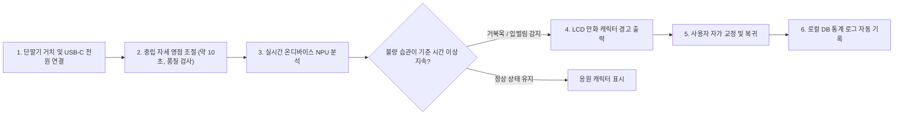

# [PRD] 거북목 & 입벌림 AI 코치 (Neck & Mouth AI Coach)

> **문서 메타데이터**
> - **프로젝트 명**: 거북목 & 입벌림 AI 코치 (Neck & Mouth AI Coach / Desk Posture Coach)
> - **버전**: v1.4.1 (기기 단독 동작 명시, LCD·버튼 캘리브레이션, 통신·컴패니언 앱 표현 정합화)
> - **작성일**: 2026-10-06 (최초) / 2026-10-07 (v1.1.0 수정) / 2026-10-12 (v1.2.3 수정) / 2026-10-16 (v1.3.0, v1.4.0 수정) / 2026-10-20 (v1.4.1 수정)
> - **상태**: v1.4.1 초안 (검토 필요)

---

## 1. 문제 정의 (Problem Statement)

### 1.1 현재 문제
현대 사무직 종사자 및 학생들은 컴퓨터 화면을 장시간 집중하여 볼 때 무의식적으로 고개를 앞으로 숙이는 **거북목(Forward Head Posture)** 상태를 취하거나, **구강 호흡으로 인해 입을 벌리는 습관**을 지속하게 됩니다.  
이는 경추 추간판 탈출증, 목·어깨 만성 통증, 턱관절 장애, 집중력 저하 및 안면 윤곽 변화 등 심각한 신체적·생리적 문제를 유발합니다.

### 1.2 기존 방식의 한계
- **정기적 타이머/알람 앱**: 사용자 실제 신체 상태와 관계없이 고정된 시간에 작동하므로 실제 불량 자세 발생 순간을 교정하지 못합니다.
- **착용형(Wearable) 교정 센서**: 목이나 어깨에 장비를 직접 부착해야 하여 이물감 및 착용 피로도가 크며, 입벌림 현상은 감지할 수 없습니다.
- **PC 소프트웨어형 웹캠 분석**: PC의 CPU/GPU 자원을 크게 점유하고, 사용자 영상이 소프트웨어를 타고 외부나 메모리에 노출되어 **프라이버시 침해 우려**가 큽니다.

### 1.3 핵심 가치
사용자의 신체에 아무것도 부착하지 않는 **비침습적(Non-intrusive) 온디바이스 에지 AI**를 통해, 거북목과 입벌림 두 가지 불량 습관에만 집중하여 실시간 감지 및 직관적인 시각 피드백(만화 캐릭터)을 제공합니다.  
**기기 단독 동작**이 기본입니다. 처음 설치와 캘리브레이션까지 본체 LCD와 버튼으로 끝나고, 그 뒤로는 PC 없이 전원만 있으면 동작합니다. PC·휴대폰 브라우저는 실시간 영상 보기, 통계, 세부 설정을 위한 부가 기능입니다.

### 1.4 AI 도입의 필요성
조명 환경, 사용자의 얼굴 각도 회전, 안경 착용 여부 등 다양한 환경 변화 속에서도 정면 영상의 얼굴 랜드마크와 얼굴·상체 영역으로 거북목(개인 기준 대비 변화)과 구강 개폐 비(Mouth Aspect Ratio, MAR)를 정확히 판별하기 위해서는 단순 정적 알고리즘이 아닌 **실시간 경량 랜드마크 추출 모델과 개인 기준 대비 판정 로직**이 필수적입니다.

---

## 2. 사용자 시나리오 (User Scenario)

1. **설치 및 위치 잡기**: 사용자가 제품을 모니터 상단에 두고 USB-C 케이블을 PC의 USB-C 포트나 USB-C 충전기에 연결합니다. 기기 LCD가 카메라 화면 위에 얼굴·어깨 위치 안내를 보여 주며, 카메라 화각 내에 사용자 상반신과 얼굴이 정상적으로 위치하도록 안내합니다. 같은 안내를 PC·휴대폰 브라우저의 설치 가이드 페이지에서 크게 볼 수도 있습니다(5.1-10). 설치 가이드는 얼굴 위치, 정면 정도(yaw), 어깨 가시성이 **허용 설치 범위**(5.4) 안인지 검증하며, 벗어나면 캘리브레이션을 진행하지 않고 위치 재조정을 안내합니다.
2. **데이터 수집 및 초기가이드**: 사용자가 기기 LCD 안내(또는 웹 페이지)에 따라 카운트다운(약 3초) 후 바른 자세와 입을 다문 상태를 약 10초간 유지합니다. 선택적으로 입을 의도적으로 살짝 벌린 상태를 3~5초 추가로 촬영해 개인별 입벌림 임계값을 정합니다. AI는 중립(Neutral) 자세 시의 얼굴·어깨 특징값과 입 닫힘 기준 데이터를 수집하며, 움직임이 크거나 유효 표본이 부족하면 **재촬영을 요청**합니다. 이 기준은 사용 중 자동 갱신하지 않고, 사용자가 명시적으로 재캘리브레이션할 때만 갱신합니다.
3. **실시간 Edge AI 분석**: 제품 내부의 에지 AI 센서가 RGB 영상 스트림을 프레임 단위로 수집하고, 온디바이스 NPU를 통해 얼굴 랜드마크 및 얼굴·상체 영역(분할 마스크)을 실시간 추출합니다.
4. **판단 결과 생성**:
   - **거북목 감지**: 정면 영상에서 얻는 간접 신호를 조합한 **개인 기준 대비 편차**가 임계값을 넘은 상태가 기준 시간 이상 지속되는지 판단합니다. 기준 시간은 시작값 30초이며 사용자에 따라 30초~3분 범위에서 조정합니다. 절대 경추 각도(CVA)를 직접 측정하지는 않습니다.
   - **입벌림 감지**: 입술 상하 거리와 좌우 거리의 비율(MAR)을 산출하여 개인 임계값 이상의 상태가 기준 시간(시작값 8초) 이상 지속되었는지 판단합니다. 말하기 등 짧은 주기의 개폐 반복은 정상 입 움직임으로 제외합니다.
   - **판정 보류**: 손·컵 등으로 가려졌거나, 얼굴이 정면 허용 범위를 벗어났거나, 영상 품질(과어두움·과밝음·흐림)이 불량한 구간은 오판정 대신 판정을 보류합니다.
   - 위 기준 시간과 임계값은 시작값이며 PoC 및 사용자 테스트로 확정합니다.
5. **디바이스 제어 및 알림**: 불량 습관이 판정되면 디바이스 전면에 탑재된 LCD 디스플레이에 입을 벌리고 있는 만화 캐릭터 또는 목을 길게 빼고 있는 만화 캐릭터 그래픽을 즉시 출력합니다.
6. **후속 행동 및 기록**: 사용자가 디스플레이의 경고 캐릭터를 확인하고 고개를 집어넣거나 입을 다뭅니다. 바른 자세로 복귀하면 디스플레이가 정상 응원 그래픽으로 전환되며, 횟수 및 불량 유지 시간 로그가 기기 내부 로컬 DB에 자동 기록되며, PC·휴대폰 브라우저에서 조회할 수 있습니다.
7. **개인 적응 및 알림 조절**: 사용 중 개인 환경에 맞춰 다음 항목만 적응합니다. 모델 재학습이 아니라 통계 갱신 수준입니다.
   - 입 다문 상태의 MAR 분포와 발화 패턴 통계 갱신
   - 사용자 피드백(오탐 신고, 알림 후 반응 패턴)에 따른 민감도·기준 시간 조정 (허용 범위 안에서만)
   - 조명 변화나 카메라 위치 이동이 감지되면 재캘리브레이션 **제안**
   - **기준 자세는 자동으로 갱신하지 않습니다.** 습관화된 나쁜 자세를 정상으로 학습하는 것을 방지하기 위함입니다.
   - 알림이 반복되어 피로를 유발하지 않도록 쿨다운, 스누즈, 일일 알림 상한을 둡니다 (수치는 사용자 테스트로 결정).

---

## 3. 성공 지표 (Success Metrics)

| 지표명 | 목표 수치 | 세부 기준 |
| :--- | :--- | :--- |
| **거북목 감지 정확도 (Precision/Recall)** | **≥ 95%** | 이벤트 단위(알림 1회 = 1건), 정면 설치 기준(허용 설치 범위 내). 정답은 측면 보조 카메라로 측정한 CVA 기반 |
| **입벌림 감지 정확도 (Precision/Recall)** | **≥ 93%** | 이벤트 단위. 정답은 입술 내측 간격 라벨(입 너비 대비 비율과 지속시간, 수치는 PoC에서 정의). 발화·하품·식사의 처리 규칙을 사전 정의 |
| **추론 및 알림 지연 시간 (Latency)** | **≤ 100ms** | 판정 조건 충족이 확정된 시점부터 LCD 피드백 전환까지 (판정 지속시간과 별개) |
| **오탐율 (False Positive Rate)** | **≤ 3%** | 알림 이벤트 중 오알림 비율. 음료 섭취, 대화, 손 가림 등 정상 행동 구간을 포함해 평가하며, 시간당 오알림 상한은 별도 정의(TBD) |
| **사용자 행동 전환율 (Action Compliance)** | **≥ 80%** | 알림 발생 후 5초 이내 바른 자세 복귀 비율 |
| **온디바이스 시스템 연속 가동 안정성** | **프레임 드랍률 ≤ 1%** | 8시간 연속 가동 기준 |

**지표 적용 원칙**

- 위 수치는 **제품(양산) 목표**입니다. 시제품(5.3)의 1차 목표는 수치 달성이 아니라 **지표를 측정할 수 있는 평가 체계를 갖추는 것**입니다.
- 정확도 지표는 정답 데이터(측면 카메라 CVA, 입술 간격 라벨)가 있어야 측정할 수 있으므로, 평가용 데이터 수집 방법을 PoC에서 함께 정합니다.
- 평가 데이터는 습관이 있는 사용자를 포함하고 조명 조건을 다양하게 구성합니다. 규모는 이벤트 약 300건 이상을 목표로 합니다. (실제 정확도 97%일 때 정규 근사 기준으로 95% 신뢰하한을 확인할 수 있는 규모이며 추정치입니다. 확정은 평가 설계 시 재계산합니다.)

---

## 4. 기술 스택 (Technology Stack)

| 구성 요소 | 사용 기술 | 선정 이유 |
| :--- | :--- | :--- |
| **카메라 (Camera)** | 1080p 이상 RGB 센서 카메라 모듈 (저조도에 강한 Sony IMX 계열 우선), 수평 화각 약 70~78°의 왜곡이 적은 렌즈, 720p@30fps 이상으로 운용 | 사용 거리 50~80cm에서 어깨와 얼굴 ROI(모델 입력 192px 이상)를 모두 확보하기 위한 조건입니다. 구체적인 제품은 하드웨어 사양서에서 정의합니다. |
| **MCU / SoC** | **요구 조건**: INT8 NPU, 카메라 입력, USB 디바이스 모드(시제품: USB 가상 네트워크 / 양산: UVC + HID 검토), Wi-Fi, 리눅스 + RKNN 계열 툴체인 지원. 시제품은 RK3566급 SBC로 알고리즘을 검증하고, 양산 후보 SoC(RV1126B, RV1106G3 등)는 PoC 결과로 결정 | 카탈로그 TOPS와 실제 성능은 다르므로 목표 모델의 **실측 지연**으로 판단합니다. RV1106는 G2(0.5 TOPS, 128MB)와 G3(1 TOPS, 256MB)의 사양이 다르고 RKNN-Toolkit2의 지원도 제한적이라 우선 후보로 고정하지 않습니다. |
| **디스플레이 (Display)** | 2.0인치 IPS TFT-LCD (320×240, SPI) | 시야각이 넓어 책상 위 어느 각도에서도 만화 피드백 캐릭터를 명확히 식별 가능 |
| **Edge AI Framework** | RKNN-Toolkit2 / RKNN Runtime (INT8 Quantization) | 선정 SoC가 해당 툴체인을 지원해야 합니다 (구형 칩은 구형 툴체인을 쓰는지 확인). TFLite Micro는 MCU용이라 제외합니다. 추론 주기는 시작값으로 상체 분할 3~5fps, 얼굴·입 랜드마크 10~15fps이며 실측으로 조정합니다. |
| **AI 모델 (Model)** | 얼굴·상체 영역을 분할하는 경량 모델(거북목 신호), 입술 내측 점을 추출하는 얼굴 랜드마크 모델(입벌림). 온디바이스 INT8 실행 | 정확도를 우선하되, 지연 ≤100ms와 연산 예산을 만족하는 범위에서 INT8 변환 후 오차를 먼저 평가합니다. |
| **통신 프로토콜** | USB 모드: USB 2.0 가상 네트워크(RNDIS/NCM) + HTTPS / Wi-Fi 모드: Wi-Fi(WPA2/WPA3-Personal) + HTTPS. 양산 단계에서 USB UVC + HID 복합 장치 검토 | 전원은 USB-C 하나로 받고, PC에 직결하면 USB, 충전기에 연결하면 Wi-Fi로 PC 브라우저와 연결합니다. UVC + HID는 드라이버 없는 플러그앤플레이를 위해 양산 단계에서 검증하며 시제품(5.3)에서는 제외합니다. |
| **설치 가이드** | 기본: 기기 LCD + 버튼 1개 / 부가: 기기 내장 웹 페이지 (PC·휴대폰 브라우저로 접속). 컴패니언 앱(Electron 등)은 양산 단계에서 검토 | PC 없이도 설치·캘리브레이션 가능. 웹 페이지는 별도 설치 없이 Windows·macOS·휴대폰 모두 지원 |
| **데이터베이스** | SQLite (기기 내장 eMMC) | 사용자 포즈 통계 데이터의 외부 유출 방지 및 기기 단독 동작. PC·휴대폰 브라우저는 기기에 접속해 조회만 합니다. |
| **대시보드** | React / Chart.js (기기 웹 페이지에서 제공) | 일/주/월별 거북목 및 입벌림 유발 빈도를 직관적인 그래프로 시각화 |

---

## 5. 개발 범위 (Scope)

### 5.1 개발 범위 (In Scope)
1. **실시간 거북목 감지**: 정면 영상에서 얻는 간접 신호를 조합해 **개인 기준 대비 변화량**을 판정 (절대 경추 각도 측정은 범위 외)
2. **실시간 입벌림 감지**: 얼굴 랜드마크 기반 구강 개폐 비율(Mouth Aspect Ratio, MAR) 산출 및 감지 (개인별 임계값 적용, 발화·가림 구간 제외)
3. **온디바이스 LCD 그래픽 제어**: 감지된 자세 상태(정상/거북목/입벌림)에 따른 실시간 만화 캐릭터 피드백 출력
4. **기기 단독 설치·캘리브레이션과 웹 설치 가이드**: 기기 LCD와 버튼 1개만으로 허용 설치 범위 검증(위치 잡기 화면)과 중립 자세 영점 조절(품질 검사 및 재촬영)을 끝낼 수 있게 하고, 같은 과정을 PC·휴대폰 브라우저의 웹 페이지로도 제공
5. **기기 웹 페이지 통신**: USB 모드(USB 가상 네트워크)와 Wi-Fi 모드에서 HTTPS로 PC·휴대폰 브라우저와 연결해 설정값 전달과 포즈 상태 로그 조회 제공 (연결 방식과 보안은 5.1-10). USB UVC + HID 복합 장치는 양산 단계에서 검토
6. **로컬 데이터 저장 및 대시보드**: 개인 프라이버시를 보장하는 기기 내장 로컬 DB와, 기기 웹 페이지에서 보는 사용자 통계 리포트 화면 제공
7. **환경 보정**: 카메라 자동노출 설정(캘리브레이션 후 완만화 또는 고정 검토)과 프레임 품질 게이트(과어두움·과밝음·흐림 시 판정 보류). CLAHE·감마·롤 정렬 등 이미지 보정은 효과가 입증된 경우에만 도입합니다.
8. **개인 적응**: 입 임계값·발화 패턴 통계 갱신, 사용자 피드백 기반 민감도 조정, 재캘리브레이션 제안 (기준 자세 자동 갱신 제외). 피드백 입력(오탐 신고 등)은 기기 웹 페이지를 경유합니다. (시제품은 통계 갱신만 적용, 5.3 참조)
9. **알림 피로 방지**: 쿨다운, 스누즈, 일일 알림 상한 (수치는 사용자 테스트로 결정)
10. **연결 모드 이중 지원과 실시간 영상 보기 보안**: USB-C 하나로 전원을 받고, PC 직결 시 USB 가상 네트워크, USB-C 충전기 연결 시 Wi-Fi로 PC·휴대폰 브라우저와 연결합니다. 실시간 영상 보기는 기기 화면에 뜬 코드로 등록한 PC에서만(USB 직결은 등록 생략) 가능하며, 시작 전 기기 화면에 카운트다운, 보는 동안 "영상 보기 중"을 표시하고, 최대 시간이 지나면 자동 종료합니다. 통신은 HTTPS로 암호화하고 같은 공유기 안에서만 접속을 허용합니다. 본체에는 버튼 1개(짧게: 스누즈, 3초: 캘리브레이션, 10초: 설정 메뉴)를 두고, 설정용 자체 Wi-Fi는 10분 뒤 자동으로 닫습니다.

### 5.2 개발 제외 범위 (Out of Scope)
- **음성 인식 및 음성 알림 기능**: 마이크/스피커를 활용한 음성 기반 교정 안내 기능 제외 (시각 피드백 중심)
- **모바일 앱(iOS/Android) 개발**: 앱 설치형 스마트폰 연동은 제외. 단, 휴대폰 브라우저로 기기 웹 페이지에 접속하는 것은 가능(5.1-10)
- **클라우드 서버 연동 및 AI 추론**: 모든 비디오 처리 및 추론은 100% 디바이스 내부에서 완결 (No Cloud)
- **기타 전신 자세 교정**: 허리 구부림, 골반 틀어짐, 어깨 불균형 등 목과 입 이외의 관절 추적 제외
- **다국어 지원 및 기업용 멀티 계정**: 단일 사용자 전용으로 제한
- **Bluetooth 및 내장 배터리**: Bluetooth 통신과 내장 배터리 제외 (전원은 USB-C 전용). Wi-Fi는 충전기에 연결했을 때 PC 브라우저와 연결하는 용도로만 쓰며(5.1-10), 기기 간 통신이나 인터넷·클라우드 연결은 하지 않습니다.
- **절대 경추 각도(CVA) 직접 측정 및 측면 설치 전용 모드**: 정면 설치를 전제로 하며, 거북목은 개인 기준 대비 변화량으로 판정
- **사용 중 기준 자세 자동 갱신**: 기준 자세는 사용자가 명시적으로 재캘리브레이션할 때만 갱신
- **마스크·모자 착용, 역광 창문 환경 지원**: 지원 범위 밖이며 품질 게이트나 판정 보류로 처리

### 5.3 시제품(1차) 범위

- **목적**: 알고리즘, 사용자 경험, 폼팩터를 한 번 직접 만들어 검증합니다.
- **포함**: 개발 보드 + 카메라 + 디스플레이(초기에는 외부 모니터 사용 가능, 이후 소형 LCD)로 온디바이스 추론, 캐릭터 피드백, 보드 로컬 DB 로그, 3D 프린트 케이스(자체 제작)
- **제외**: UVC + HID 복합 장치, 컴패니언 앱(Electron 등), 통계 대시보드 화면, 피드백 기반 민감도 조정, 8시간 가동 안정성과 제품 목표 수치(95% 등) 달성
- **개인 적응 범위**: 시제품은 입 다문 상태의 MAR 분포와 발화 패턴의 **통계 갱신**에 한정합니다. 기준 자세 자동 갱신 금지는 동일하게 적용합니다.
- **1차 목표**
  - 정면 간접 신호와 측면 CVA의 상관 확인 (측면 보조 카메라 동기 촬영)
  - 3장 지표를 측정할 수 있는 평가 체계 구축
  - 선정 모델 평가 (FP32 정확도 → INT8 변환 후 정확도, 목표 보드 지연 실측)
- **개발 단계(참고)**: M1 PC에서 기준 출력 모델로 특징과 판정 로직 검증 → M2 개발 보드로 경량 모델 이식 및 비교 → M3 LCD, 로그, 개인 적응(통계 갱신 한정) → M4(선택) 양산 후보 SoC 이식 및 UVC/HID 검증

### 5.4 전제 및 한계 (사용 조건)

| 항목 | 기준 | 비고 |
| :--- | :--- | :--- |
| **사용자** | 단일 사용자 | 5.2와 동일 |
| **설치 위치** | 모니터 상단 중앙, 카메라 높이는 눈높이 이상 | 책상 위 거치는 카메라가 눈보다 낮아져 신호의 부호가 달라질 수 있으므로 별도 검증 전까지 지원 범위에서 제외 |
| **사용 거리** | 50~80cm | **가정값**입니다. 현장 확인이 필요합니다. |
| **얼굴 정면 정도** | 정면 ±30° 이내 (시작값) | 약간 측면으로 설치된 경우의 정적 오프셋은 캘리브레이션이 흡수하고, 허용 범위를 넘으면 재설치를 안내합니다. 사용 중 허용 범위를 넘으면 판정을 보류합니다. |
| **가림** | 손, 컵 등으로 가려지면 판정 보류 | 오탐 방지 |
| **비지원 환경** | 마스크, 모자, 역광 창문 | 5.2 참조 |
| **작업·학습 방식** | 모니터를 보는 작업·학습 (인강, 코딩, 문서 작업) | 종이 책·노트 위주 학습은 고개를 크게 숙여 판정 보류가 잦거나 오판할 수 있어 지원 범위 밖 |
| **노트북 단독 사용** | 지원 범위 밖 | 노트북 화면 위는 보통 눈높이보다 낮아 설치 위치 조건(카메라 높이 눈높이 이상)을 만족하지 못함 |
| **전원** | USB-C 전용 (PC의 USB-C 포트 또는 5V ≥2A USB-C 충전기) | 충전기만으로도 핵심 기능 전체 동작. USB-A 포트는 미지원 |
| **네트워크 (Wi-Fi 모드)** | WPA2/WPA3-Personal 공유기 | 사내 Enterprise 인증 Wi-Fi는 미지원. 사무실은 USB 모드 권장 |
| **판정 방식** | 개인 기준 대비 변화 | 정면 간접 신호이므로 절대 각도가 아님 |

---

## 6. ROI 분석 및 비즈니스 가치 (Business Value)

> **분석 기준**: 가상의 B2B 기업 (사무직 임직원 100명 규모 조직) 도입 기준

| 구분 | 금액 (원) | 세부 내역 및 산출 근거 (가정) |
| :--- | :--- | :--- |
| **초기 투자비 (CAPEX)** | **20,000,000** | H/W 단말기 100대 × 120,000원 + SW 커스터마이징 8,000,000원 |
| **월 절감액 (Gross Benefit)** | **5,000,000** | 1인당 월 50,000원 상당의 몰입도/생산성 향상 × 100명 |
| **월 운영비 (OPEX)** | **500,000** | 단말기 전력비 100,000원 + 유지보수 공수 400,000원 |
| **월 순 절감액 (Net Benefit)** | **4,500,000** | 월 절감액 - 월 운영비 |
| **연간 순 절감액** | **54,000,000** | 월 순 절감액 × 12개월 |
| **연간 ROI (%)** | **270%** | (연간 순 절감액 / 초기 투자비) × 100 |
| **투자 회수 기간 (Payback)** | **약 4.4개월** | 초기 투자비 / 월 순 절감액 |

### 6.1 최종 판정 결과
100인 사무 조직 기준 도입 시 초기 투자금 2,000만 원은 **약 4.4개월 이내에 전액 회수**되며, **연간 270%의 높은 투자 대비 수익률(ROI)**을 달성합니다.  
경추 질환 및 구강 건조로 인한 임직원의 병가 발생률 감소 및 업무 집중도 향상 효과를 고려할 때, 본 제품은 비침습적이고 프라이버시 위험이 없는 경제적인 피지컬 AI 솔루션으로서 신속한 투자 승인이 타당합니다.

---

## 7. 미결 사항 및 검증 항목 (Open Issues)

| 우선순위 | 항목 | 비고 |
| :--- | :--- | :--- |
| 🔴 | **정면 간접 신호와 측면 CVA의 상관 검증** | 실패 시 5.1의 거북목 판정 방식을 재정의해야 합니다. |
| 🔴 | 입술 내측 점의 정확도(점 지터, 편향)와 보드 이식 가능 여부 | 입벌림 지표를 좌우합니다. |
| 🔴 | 목표 SoC에서의 실제 NPU 성능과 연산 예산 실측 | 상체 분할 3~5fps, 얼굴 10~15fps 가정의 검증 |
| 🟠 | 사용 거리·카메라 높이·화각 현장 확인 | 현재 50~80cm는 가정이며 현장 조사표도 미작성 상태입니다. |
| 🟠 | 거북목·입벌림 판정 기준 시간 및 임계값 수치 확정, 알림 피로 파라미터 | 시작값은 2장 참조 |
| 🟠 | 평가 데이터 규모와 구성 (습관 있는 사용자 포함) | 3장 원칙 참조 |
| 🟡 | UVC + HID 복합 장치 구현 가능성 | 시제품에서 제외, 양산 단계 검증 |
| 🟠 | Wi-Fi 모드 보안 검증 (PC 등록 코드, HTTPS 인증서 경고 처리, 외부 연결 차단) | 설계는 report/container_architecture.md 4.1 |
| 🟠 | LCD 캘리브레이션의 기준 자세 치우침 (모니터 위 LCD를 보면 고개가 들림) | 같은 사람의 웹 방식 기준값과 비교해 PoC에서 확인 |
| 🟡 | UVC로 영상이 PC에 전달되는 구조에서의 프라이버시 주장(1.2) 충족 방안 | 시제품은 실시간 보기 보안 장치(5.1-10)로 대응. UVC 방식은 양산 단계에서 재검토 |
| 🟡 | 지연 ≤100ms의 정의 합의 | 3장은 "판정 확정 후 LCD 전환"으로 정의했습니다. |
| 🟡 | 오픈소스 모델·라이브러리의 상업 배포 라이선스 확인 | 6장 B2B 판매 시나리오의 전제입니다. 라이선스 비용이 생기면 ROI에 반영합니다. |

---

## 8. 버전 변경 이력 (Changelog)

| 버전 | 날짜 | 작성자/수정자 | 변경 내용 요약 |
| :--- | :--- | :--- | :--- |
| **v1.0.0** | 2026-10-06 | 프로젝트 팀 | docx 원본 기반 최초 마크다운 PRD 문서화 완료 |
| **v1.1.0** | 2026-10-07 | 프로젝트 팀 (초안 작성 보조: Claude) | 시제품 개발 기준으로 수정: ① 거북목 판정을 정면 간접 신호 기반 개인 기준 대비 변화로 재정의 ② 캘리브레이션을 약 10초와 품질 검사로 변경 ③ 판정 시간을 행동별 시작값으로 변경(거북목 30초, 입벌림 8초) ④ 개인 적응 범위와 알림 피로 방지 추가 ⑤ 성공 지표를 이벤트 단위로 정의하고 평가 원칙 추가 ⑥ 기술 스택을 요구 조건 중심으로 수정(SoC 고정 해제, TFLite Micro 제거, 모델 선정 기준 명시) ⑦ 시제품 범위(5.3)와 전제·한계(5.4) 신설 ⑧ 미결 사항(7장) 신설 ⑨ 시제품의 개인 적응을 통계 갱신으로 한정하고 설치 위치 문구를 모니터 상단으로 정합화 |
| **v1.2.2** | 2026-10-12 | 프로젝트 팀 (초안 작성 보조: Claude) | 모델 선정·학습·검증의 세부 내용(모델 이름, 학습 설정, 실험·검증 계획, 관련 미결 사항)을 PRD 범위에서 제외. 요구 조건, 지표, 범위 중심으로 정리 |
| **v1.2.3** | 2026-10-12 | 프로젝트 팀 (초안 작성 보조: Claude) | 7장에 오픈소스 모델·라이브러리의 상업 배포 라이선스 확인 항목 추가 |
| **v1.3.0** | 2026-10-16 | 프로젝트 팀 (초안 작성 보조: Claude) | 연결 방식 변경: ① 전원은 USB-C 전용 ② PC 직결 시 USB, 충전기 연결 시 Wi-Fi로 PC 브라우저와 연결(5.1-10) ③ 설치 가이드를 기기 내장 웹 페이지로 변경하고 실시간 영상 보기와 보안 장치 추가 ④ 5.2의 무선 제외 범위를 Bluetooth로 축소 ⑤ 5.4에 전원·네트워크 조건, 7장에 Wi-Fi 보안 검증 항목 추가 |
| **v1.4.0** | 2026-10-16 | 프로젝트 팀 (초안 작성 보조: Claude) | ① 1.3에 기기 단독 동작(PC·휴대폰은 부가 기능) 명시 ② 설치·캘리브레이션을 기기 LCD와 버튼 1개로 가능하게 변경(2장, 5.1-4) ③ 기록은 기기 내부 DB, 브라우저는 조회만(2장, 4장) ④ 휴대폰 브라우저 접속 허용(5.2) ⑤ 설정용 자체 Wi-Fi 10분 제한 ⑥ 5.4에 작업·학습 방식과 노트북 단독 사용 조건 추가 ⑦ 7장에 LCD 캘리브레이션 치우침 항목 추가 |
| **v1.4.1** | 2026-10-20 | 프로젝트 팀 (초안 작성 보조: Claude) | v1.3.0~v1.4.0의 연결 방식(USB 가상 네트워크·Wi-Fi + 기기 웹 페이지)에 맞춰 남아 있던 이전 표현 정합화: ① 4장 SoC 요구 조건의 USB 디바이스 모드를 시제품 가상 네트워크 / 양산 UVC + HID 검토로 구분하고 Wi-Fi 추가 ② 5.1-5를 "USB HID/UVC 복합 통신"에서 "기기 웹 페이지 통신"으로 변경(UVC + HID는 양산 검토) ③ 5.1-6 대시보드를 기기 웹 페이지 제공으로 명시 ④ 5.1-8 피드백 입력 경로를 컴패니언 앱에서 기기 웹 페이지로 변경 ⑤ 5.2의 "PC 컴패니언 소프트웨어" 표현 제거 ⑥ 5.3 제외 항목의 컴패니언 앱 표현을 4장과 맞춤 |
