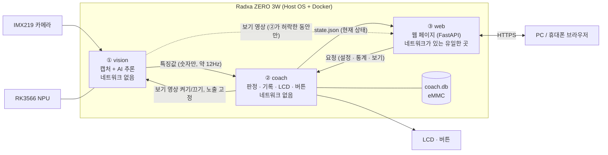

# 거북목 & 입벌림 AI 코치 — SBC 컨테이너 구조 설계

> **문서 메타데이터**
> - **프로젝트**: 거북목 & 입벌림 AI 코치 (Neck & Mouth AI Coach / Desk Posture Coach)
> - **범위**: SBC(Radxa ZERO 3W, RK3566) 안의 소프트웨어를 Docker 컨테이너로 나누는 구조
> - **버전**: v2.1.0
> - **작성일**: 2026-10-16 (v1.x) / 2026-10-20 (v2.0.0, v2.1.0)
> - **v2.0.0 변경**: 컨테이너 5개 → **3개**로 줄임. 카메라 하나에 파이프라인 하나인 제품이라 수집·추론을 합치고, 판정·화면·버튼을 합침. 통신 통로와 보안 장치도 꼭 필요한 것만 남김
> - **v2.1.0 변경**: 객관적인 설계 자료로 정리 (외부 맥락 설명 제거)
> - **상태**: 초안. 아직 보드에서 실행해 보지 않았습니다. 메모리 수치는 시작값입니다.

---

## 1. 설계 전제

| 하드웨어 | 연결 | 쓰는 컨테이너 |
| :--- | :--- | :--- |
| Sony IMX219 카메라 | MIPI CSI-2 | ① vision |
| RK3566 NPU (0.8 TOPS) | SoC 내장 | ① vision |
| 2.0" ST7789 LCD | SPI + GPIO | ② coach |
| 택트 스위치 1개 | GPIO | ② coach |
| eMMC 16GB | 보드 내장 | ② coach (기록 DB) |
| PC 연결 | USB 가상 네트워크(`usb0`) 또는 Wi-Fi(`wlan0`) | ③ web |

- 보드: Cortex-A55 4코어, RAM **2GB 기준**. 부품 선정 근거는 [hardware_spec_report.md](hardware_spec_report.md).
- **기기 단독 동작이 기본**입니다. 감지 → LCD 경고 → 기록까지 PC 없이 돌아가고, PC·휴대폰 브라우저는 통계·설정·실시간 보기용 부가 기능입니다.
- 모터·비상정지처럼 멈추면 사고로 이어지는 부분이 없습니다. 대신 **사용자 얼굴을 계속 찍는 기기**라서 "영상이 어디까지 닿는가"(보안)를 가장 중요한 분리 기준으로 둡니다.
- 카메라·LCD·버튼은 모두 SBC에 직접 연결되고, 컨테이너 사이 통신은 보드 안의 공유 RAM 볼륨과 Unix 소켓으로 합니다 (5장).

---

## 2. 컨테이너 구조도



---

## 3. 컨테이너별 역할

| # | 컨테이너 | 하는 일 | 장치 | 네트워크 | 재시작 |
| :---: | :--- | :--- | :--- | :---: | :--- |
| ① | `vision` | 카메라 캡처 → 품질 검사 → RKNN 추론(상체 분할, 얼굴·입술 랜드마크) → 특징값 전송 | 카메라, NPU | 없음 | `on-failure` + `mem_limit` |
| ② | `coach` | 거북목·입벌림 판정, 캘리브레이션, SQLite 기록, LCD 캐릭터 표시, 버튼 처리, 영상 보기 허락 | SPI, GPIO | 없음 | `always` |
| ③ | `web` | 통계·설정 웹 페이지, 실시간 보기 중계 | 없음 | **있음** | `always` |

- Wi-Fi 켜기·끄기(USB 모드 / Wi-Fi 모드 전환)는 호스트 네트워크 권한이 필요해서 컨테이너가 아니라 **호스트 OS(NetworkManager)** 가 합니다.

---

## 4. 분리 기준

| 기준 | 이 문서 |
| :--- | :--- |
| 하드웨어 접근 권한 · 보안 (가장 중요) | 4.1 |
| 실패 영향도 | 4.2 |
| 데이터 라이프사이클 · 역할 | 4.3 |
| 라이브러리 의존성 | 4.4 |

### 4.1 하드웨어 접근 권한과 보안 (가장 중요)

**원칙: 얼굴 영상이 있는 곳과 밖으로 나가는 길이 있는 곳을 나눈다.**

| 지킬 것 | 닿는 곳 |
| :--- | :--- |
| 얼굴 원본 영상 | ①뿐. RAM에만 있고 디스크·네트워크로 나가지 않음 |
| 자세 기록, 개인 기준값 | ②뿐 (③은 요청만) |
| 밖(PC)과의 연결 | ③뿐 |

- ①·②는 `network_mode: none`입니다. ①이 뚫려도 영상을 밖으로 보낼 길이 없습니다.
- ③은 카메라에 직접 명령할 수 없습니다. 실시간 보기는 ③이 요청 → **②가 허락하고 LCD에 "영상 보기 중" 표시** → ②가 ①에 보기 영상을 켜라고 함, 순서로만 시작됩니다.
- 실시간 보기 보안 장치 (PRD 5.1-10):
  - Wi-Fi 모드에서는 처음 한 번 **기기 화면의 4자리 코드**로 PC를 등록해야 접속 가능 (USB 모드는 케이블 1:1 연결이라 생략)
  - 보는 동안 LCD에 "영상 보기 중" 계속 표시, 최대 5분, 저해상도(320×240)
  - 통신은 HTTPS. 기기에서 인터넷으로 나가는 연결은 호스트 방화벽에서 차단
- 모든 컨테이너에 `cap_drop: ALL`, `no-new-privileges`를 주고, `privileged` 대신 필요한 장치만 `devices`로 연결합니다.

### 4.2 실패 영향도

어느 컨테이너가 멈춰도 다치는 사람은 없습니다. 그래도 **틀린 화면이 굳어 있지 않게** 하는 것이 목표입니다.

| 멈춘 것 | 사용자에게 보이는 것 | 복구 |
| :--- | :--- | :--- |
| ① vision (메모리를 가장 많이 써서 OOM 가능성이 가장 큼) | 특징값이 2초 넘게 안 오면 ②가 LCD에 **"대기"** 화면. 틀린 경고 없음 | 자동 재시작 |
| ② coach | LCD 갱신이 멈춤. ①은 ②의 신호가 끊기면 보기 영상을 스스로 끔 | 자동 재시작, eMMC의 기준값을 다시 읽음 |
| ③ web | 브라우저 연결만 끊김. 기기 코칭은 그대로 | 자동 재시작 |

- 잠깐 멈춰도 되는 구역(①)을 한 컨테이너에 모으고 `mem_limit`을 걸어, 메모리가 넘쳐도 ①만 종료되고 나머지는 계속 돌게 합니다.
- Docker 재시작 정책은 프로세스가 **종료**됐을 때만 동작합니다. 그래서 ①에는 "5초 동안 프레임을 처리하지 못하면 스스로 종료"하는 감시 코드를 넣어 멈춤(hang)도 재시작되게 합니다.

### 4.3 데이터 라이프사이클과 역할

| 데이터 | 흐름 | 수명 | 저장 |
| :--- | :--- | :--- | :--- |
| 원본 프레임 | ① 안에서만 | 수십 ms | RAM |
| 특징값 (랜드마크 좌표, 분할 통계, 영상 품질) | ① → ② | 한 번 쓰고 버림 | 저장 안 함 |
| 현재 상태 (정상/거북목/입벌림/대기 등) | ② → ③ | 바뀔 때 + 1초마다 | RAM (`state.json`) |
| 알림 기록, 개인 기준값, 설정 | ② 소유 | 영구 | eMMC (SQLite) |
| 실시간 보기 영상 | ① → ③ → 브라우저 | 보기 중에만 | RAM, 녹화 없음 |

- 역할로 보면 **수집·추론(①) → 판단·출력(②) → 외부 창구(③)** 입니다.
- 설정·기록의 주인은 ② 하나입니다. ③은 요청만 하고 ②가 허용 범위를 검사합니다.

### 4.4 라이브러리 의존성

| 컨테이너 | 주요 라이브러리 | 따로 두는 이유 |
| :--- | :--- | :--- |
| ① vision | `rknn-toolkit-lite2`(rknnlite), `librknnrt.so`, OpenCV(headless), NumPy | **NPU 런타임 버전을 커널 드라이버 버전에 맞춰야 함.** 다른 것과 섞으면 버전을 마음대로 못 바꿈 |
| ② coach | `python:3.11-slim`, NumPy, spidev, gpiod, Pillow | 가벼움. 판정 로직은 NumPy만 쓰므로 **PC에서도 그대로** 녹화한 특징값으로 시험 가능 |
| ③ web | `python:3.11-slim`, FastAPI, uvicorn | 웹 서버와 TLS 라이브러리를 다른 컨테이너에 퍼뜨리지 않음 |

- PyTorch·ONNX는 보드에 올리지 않습니다. `.pt → .onnx → .rknn` 변환은 PC(x86)에서 하고, 보드에는 `.rknn` 파일만 넣습니다 (학습·변환과 실행을 분리).

---

## 5. 컨테이너 간 통신

| 통로 | 방향 | 방식 | 내용 |
| :--- | :--- | :--- | :--- |
| `features.sock` | ① → ② | Unix 데이터그램 소켓 (보내고 끝) | 한 줄 JSON: 시각, 랜드마크 좌표, 분할 통계, 영상 품질 |
| `vision.json` | ② → ① | RAM 공유 볼륨의 파일 | 노출 고정값, 보기 영상·위치 잡기 영상 켜기/끄기, 갱신 시각 |
| `state.json` | ② → ③ | RAM 공유 볼륨의 파일 | 현재 상태, 페어링 코드, 보기 상태 |
| `control.sock` | ③ → ② | Unix 스트림 소켓 (요청 → 응답) | 설정 변경, 통계 조회, 캘리브레이션, PC 등록, 보기 시작·종료 |
| `preview.jpg` | ① → ③ | RAM 공유 볼륨의 파일 | 보기 중에만 320×240 JPEG |
| `lcd-preview` | ① → ② | RAM 공유 볼륨의 파일 | 캘리브레이션 위치 잡기 중에만 320×240 거울 화면 (②는 네트워크가 없어 기기 밖으로 안 나감) |

- 모든 통로가 보드 안의 공유 RAM 볼륨과 Unix 소켓이라, ①·②는 네트워크 없이도 서로 데이터를 주고받습니다.

---

## 6. 기존 코드(`code/posture_pipeline`)와의 연결

`pipeline.py`의 `process_frame`(프레임 → 키포인트)과 `process_keypoints`(키포인트 → 판정) 경계가 그대로 ①과 ②의 경계입니다.

| 모듈 | 컨테이너 |
| :--- | :--- |
| `image_ops`, `models.py`, `pipeline.process_frame` | ① vision |
| `keypoints.py`, `features.py`, `calibration.py`, `decision.py`, `pipeline.process_keypoints` | ② coach |
| (새로 작성) LCD 표시, 버튼, SQLite 기록 | ② coach |
| (새로 작성) FastAPI 웹 페이지 | ③ web |

---

## 7. 컨테이너별 단독 시험 방법

| 컨테이너 | 먼저 고정할 인터페이스 | 단독 시험 방법 |
| :--- | :--- | :--- |
| ① vision | `features.sock` JSON 형식 | 저장된 영상 파일을 카메라 대신 넣기 |
| ② coach | `state.json` 형식, `control.sock` 명령 | 녹화한 특징값을 다시 보내 판정 확인 (PC에서 가능) |
| ③ web | 웹 API, 화면 | 가짜 `state.json`과 가짜 `control.sock` 응답기 |

- 5장의 통로 형식을 먼저 고정하면 컨테이너를 따로 개발한 뒤 `docker compose up`으로 합칠 수 있습니다.

---

## 8. compose 스케치 (구조 설명용, 실행 검증 안 함)

```yaml
x-hardened: &hardened
  cap_drop: [ALL]
  security_opt: ["no-new-privileges:true"]

services:
  vision:                        # ① 카메라 + NPU, 네트워크 없음
    <<: *hardened
    build: ./vision
    network_mode: none
    restart: on-failure
    mem_limit: 640m              # 넘으면 이 컨테이너만 종료 → 재시작
    devices: ["/dev/video0", "/dev/media0", "/dev/dri/renderD129"]  # 보드에서 실제 노드 확인 후 확정
    volumes: ["ipc:/ipc", "./models:/models:ro"]

  coach:                         # ② 판정 · 기록 · LCD · 버튼, 네트워크 없음
    <<: *hardened
    build: ./coach
    network_mode: none
    restart: always
    mem_limit: 192m
    devices: ["/dev/spidev3.0", "/dev/gpiochip3"]
    volumes: ["ipc:/ipc", "data:/data"]

  web:                           # ③ 네트워크가 있는 유일한 곳
    <<: *hardened
    build: ./web
    restart: always
    mem_limit: 128m
    ports: ["443:8443"]
    volumes: ["ipc:/ipc", "tls:/tls:ro"]

volumes:
  ipc:  { driver: local, driver_opts: { type: tmpfs, device: tmpfs } }   # 소켓·상태 파일·보기 영상 (RAM)
  data:                          # SQLite, 기준값 (eMMC)
  tls:
```

- 메모리 합계 약 1GB로, 2GB 보드에서 OS 몫을 남기는 시작값입니다. `docker stats`로 재서 조정합니다.

---

## 9. 보드를 받으면 확인할 것

| 우선순위 | 항목 |
| :---: | :--- |
| 1 | Docker 안에서 카메라(rkisp)와 NPU 장치 접근이 되는지. 안 되면 필요한 장치 노드를 더 찾아 추가 (`privileged`는 마지막 수단) |
| 1 | `librknnrt.so`와 커널 NPU 드라이버 버전 맞추기 |
| 2 | ① 컨테이너 하나에서 캡처 + 추론 + 후처리로 목표 3~5fps가 나오는지 |
| 2 | Docker가 연 포트가 호스트 방화벽을 우회하지 않는지 (`DOCKER-USER` 체인) |
| 3 | 컨테이너별 실제 메모리 사용량 |

