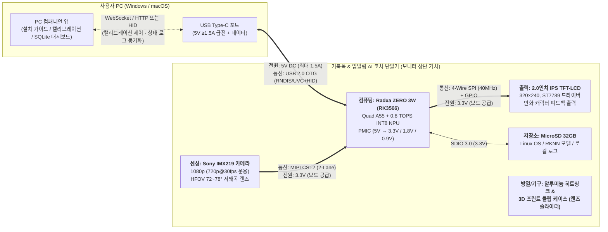

# 거북목 & 입벌림 AI 코치 — 하드웨어 시스템 사양 및 부품 선정 보고서 (BOM)

> **문서 메타데이터**
> - **프로젝트**: 거북목 & 입벌림 AI 코치 (Neck & Mouth AI Coach / Desk Posture Coach)
> - **범위**: 시제품(PoC) 하드웨어 시스템 5계층(전원·컴퓨팅·센싱·통신·출력/기구) 부품 선정, 전압·전류 전력 예산(Power Budget), 통신 인터페이스 및 핀 배선 설계
> - **버전**: v1.0.0
> - **작성일**: 2026-10-14
> - **상태**: 확정 (PC 컴패니언 앱 연동 기준)

---

## 목차

1. 하드웨어 설계 전제 및 아키텍처 개요
2. 최종 하드웨어 부품 리스트 (BOM)
3. 부품별 전압 · 전류 및 전력 예산표 (Power Budget)
4. 통신 방식 및 인터페이스 설계
5. 핀 연결표 (GPIO / CSI / SPI 배선)
6. 하드웨어 운용 리스크 및 설계 대책

---

## 1. 하드웨어 설계 전제 및 아키텍처 개요

### 1.1 설계 원칙
- **온디바이스 에지 AI**: 모든 카메라 영상 수집과 AI 추론(`YOLO-seg` 상체 분할 + 얼굴·입술 랜드마크 추출)은 클라우드나 PC 자원을 쓰지 않고 100% 단말기 내부 NPU에서 수행합니다.
- **단일 전원 설계**: PC와 연결된 USB 케이블 하나로 전원 공급과 데이터 통신을 동시에 해결합니다.
- **PC 앱 연동**: 다운로드형 **PC 컴패니언 앱**을 통해 초기 10초 영점 조절(캘리브레이션), 스누즈(알림 일시정지), 오탐 피드백 및 로컬 DB 통계 조회를 수행합니다.

### 1.2 시스템 블록 다이어그램

---

## 2. 최종 하드웨어 부품 리스트 (BOM)

PRD의 B2B 양산 목표 단가(대당 120,000원 이하)를 시제품 단계에서부터 충족하는 시제품 부품 목록입니다.

| 계층 | 부품명 | 상세 사양 | 수량 | 선정 이유 및 역할 | 예상 단가 (원) |
| :--- | :--- | :--- | :---: | :--- | ---: |
| **컴퓨팅 (SBC)** | **Radxa ZERO 3W** (또는 동급 RK3566 SBC) | Rockchip RK3566 (Quad Cortex-A55 @1.6GHz), **INT8 0.8 TOPS NPU**, LPDDR4 2GB~4GB, USB-C OTG | 1 | 초소형 폼팩터(65×30mm)로 모니터 상단 거치에 적합. `RKNN-Toolkit2` 기반 온디바이스 AI 추론 및 USB 가젯 통신 수행 | 50,000 |
| **저장장치** | **MicroSD 카드 (32GB)** | SanDisk High Endurance (Class 10, A1/A2 등급) | 1 | Linux OS 구동, RKNN INT8 모델 가중치 보관, 온디바이스 SQLite 로그 및 오탐 프레임 저장 | 10,000 |
| **센싱 (비전)** | **Sony IMX219 카메라 모듈** | 8MP 센서 (1280×720@30fps 운용), **수평 화각(HFOV) 72°~78° 비왜곡(Low Distortion <1.5%) 렌즈** | 1 | 사용 거리 50~80cm에서 가장자리 왜곡 없이 얼굴과 어깨선(`upper_body`)을 동시에 포착. 저조도 실내 환경 대응 | 25,000 |
| **출력 (디스플레이)** | **2.0인치 IPS TFT-LCD 모듈** | 320×240 해상도, **ST7789 드라이버**, 시야각 178° IPS 패널, SPI 인터페이스 | 1 | 모니터 상단에서 내려다보아도 색상 반전이 없는 광시야각 IPS 패널. 불량 습관 감지 후 ≤100ms 이내 캐릭터 그래픽 전환 | 10,000 |
| **전원 · 통신선** | **USB 2.0 Type-C 데이터 케이블** | 5V/3A 급전 규격(22AWG 전원선), USB 2.0 High-Speed(480Mbps), 1.5m~2.0m, 페라이트 코어 내장 | 1 | PC 본체와 모니터 상단 단말기를 연결하여 단일 케이블로 5V 전원 공급 및 PC 컴패니언 앱 데이터 송수신 | 6,000 |
| **방열 (열관리)** | **전용 알루미늄 히트싱크 + 써멀패드** | 20×14×6mm 알루미늄 방열핀 + 열전도율 6.0W/m·K 써멀패드 | 1 | 8시간 연속 NPU 가동 시 열 쓰로틀링(클럭 저하) 및 프레임 드랍(≤1%) 방지 | 3,000 |
| **기구 · 외장** | **모니터 클립형 하우징 (3D 프린팅)** | PLA/PETG 자체 제작, 모니터 상단 고정 경첩 클립 + **물리적 카메라 렌즈 슬라이더(셔터)** 일체형 | 1 | 모니터 상단 눈높이 고정, 통풍구 확보, 비사용 시 렌즈를 물리적으로 차단하여 프라이버시 신뢰성 확보 | 10,000 |
| **합계** | **총 7종** | — | **1식** | **PRD 목표 단가(120,000원) 이내 달성** | **114,000** |

---

## 3. 부품별 전압 · 전류 및 전력 예산표 (Power Budget)

**5V 단일 입력 레일**과 보드 내부 PMIC(전원관리칩)의 **3.3V 출력 레일**로 깔끔하게 구성됩니다. 설계 기준은 평균 전류가 아닌 **피크(Peak) 전류**입니다.

### 3.1 부품별 전압 · 전류 · 전력 상세표

| 부품명 | 동작 전압 (V) | 전원 공급원 | 평균 전류 (mA) | 피크 전류 (mA) | 평균 전력 (W) | 피크 전력 (W) | 비고 (피크 발생 조건) |
| :--- | :---: | :--- | ---: | ---: | ---: | ---: | :--- |
| **Radxa ZERO 3W (RK3566)** | **5.0V** | PC USB 포트 직결 | 550 mA | 1,100 mA | 2.75 W | 5.50 W | 부팅 시 및 NPU(`YOLO-seg`) + CPU 동시 최대 부하 시 |
| **MicroSD 카드 (32GB)** | **3.3V** | 보드 내장 PMIC | 30 mA | 80 mA | 0.10 W | 0.26 W | SQLite 로그 및 평가 프레임 연속 쓰기(Write) 시 |
| **Sony IMX219 카메라** | **3.3V** *(내부 2.8V/1.8V/1.2V)* | 보드 내장 PMIC (CSI 핀) | 140 mA | 180 mA | 0.46 W | 0.59 W | 720p@30fps 연속 스트리밍 및 ISP 파이프라인 가동 시 |
| **2.0" IPS TFT-LCD** | **3.3V** | 보드 내장 PMIC (GPIO 핀) | 70 mA | 100 mA | 0.23 W | 0.33 W | 백라이트 LED 100% 점등 및 SPI 40MHz 화면 갱신 시 |
| **시스템 전체 합계 (5V 환산)** | **5.0V 입력** | **PC USB-C 포트** | **약 730 mA** | **약 1,380 mA** | **3.65 W** | **6.90 W** | PMIC 변환 효율(약 88%) 반영 시 5V 입력단 총 전류 |

### 3.2 전원 레일 안정성 및 브라운아웃(Brownout) 방지 설계
1. **5V 주 전원 레일 요구 조건**:
   - 시스템 피크 전류가 **약 1.38A (6.90W)**이므로, 최대 500mA(2.5W)만 공급하는 구형 **USB 2.0 Type-A 포트에 연결하면 NPU 추론 순간 전압이 2.8V 이하로 강하하여 보드가 재부팅(Brownout)**됩니다.
   - 따라서 반드시 **PC의 USB-C 포트(5V / 1.5A~3.0A, 제조사 권장 2A)**에 연결하는 것을 표준 설치 조건으로 정의합니다.
2. **3.3V 서브 레일 여유율**:
   - 주변장치 3종(MicroSD + 카메라 + LCD)의 3.3V 피크 전류 합계는 `80 + 180 + 100 = 360mA`입니다.
   - Radxa ZERO 3W 온보드 3.3V 레귤레이터의 최대 출력 허용치(약 1.0A) 대비 **36% 수준**이므로, 보드 내부 전원만으로 안전하게 구동됩니다.
3. **공통 GND(접지) 구성**:
   - PC USB GND, RK3566 보드 GND, MIPI 카메라 실드 GND, SPI LCD GND를 모두 보드 내부 공통 GND 평면에 직결하여 고속 신호(MIPI, SPI)의 기준 전압 흔들림을 방지합니다.

---

## 4. 통신 방식 및 인터페이스 설계

단말기 내부 부품 간 통신과 단말기 ↔ PC 앱 간 외부 통신을 데이터 대역폭과 실시간성 기준에 맞춰 총 4가지 방식으로 분리 설계했습니다.

| 통신 구간 | 출발 ↔ 도착 | 통신 방식 (프로토콜) | 동작 속도 / 대역폭 | 신호 전압 | 선정 이유 및 전송 데이터 |
| :--- | :--- | :--- | :--- | :---: | :--- |
| **① 영상 입력 구간** | `IMX219 카메라` → `RK3566 보드` | **MIPI CSI-2** (2-Lane 데이터 + I2C 제어) | 레인당 최대 1Gbps (720p@30fps 무압축 전송) | 1.2V (MIPI) / 3.3V (I2C) | 720p@30fps 원본 영상을 CPU 개입 없이 하드웨어 ISP와 NPU 메모리(DMA)로 직결하기 위해 전용 고속 카메라 인터페이스를 사용합니다. (노출/게인 제어는 CSI 리본 내 I2C `0x10` 주소 사용) |
| **② 시각 출력 구간** | `RK3566 보드` → `2.0" IPS LCD` | **4-Wire SPI** (+ 제어용 GPIO 3핀) | 32MHz ~ 40MHz | 3.3V TTL | 320×240 RGB565 프레임(153.6KB)을 1회 전송하는 데 **약 31~38ms**밖에 걸리지 않아, PRD 목표인 **판정 후 알림 지연 ≤ 100ms**를 넉넉히 달성합니다. |
| **③ 로컬 저장 구간** | `RK3566 보드` ↔ `MicroSD 카드` | **SDIO 3.0** | 최대 50~104 MB/s | 3.3V / 1.8V | AI 모델(RKNN) 로딩 및 온디바이스 상태 통계 로그(SQLite) 고속 읽고 쓰기를 수행합니다. |
| **④ PC 연동 구간** | `RK3566 보드` ↔ `사용자 PC 앱` | **USB 2.0 OTG** *(시제품: USB RNDIS 네트워크 + WebSocket / 양산: UVC+HID 복합 장치)* | 480 Mbps (High-Speed) | 5V VBUS / 3.3V D+,D- | • **설치/캘리브레이션 시**: 가이드용 프리뷰 프레임 및 영점 조절 시작/완료 명령 송수신 • **실시간 코칭 시**: 프라이버시 보호를 위해 영상은 차단하고, 판정 이벤트(`거북목/입벌림`)·스누즈 명령·통계 로그(JSON)만 양방향 송수신 |

> **💡 시제품(PoC) vs 양산 단계의 USB 통신 전략 차이**
> - **시제품(PoC)**: 리눅스 USB Gadget의 **`USB RNDIS/NCM (USB 가상 이더넷)`** 모드를 활성화합니다. USB 케이블을 꽂으면 보드가 고정 로컬 IP(예: `192.168.7.2`)를 가진 네트워크 어댑터로 잡히며, PC 앱과 보드 내 `FastAPI` 서버가 **HTTP/WebSocket**으로 통신합니다. 필요 시 보드 내장 Wi-Fi(2.4/5GHz)를 백업 통신 채널로도 쓸 수 있어 개발 기간을 획기적으로 단축합니다.
> - **양산(M4 단계)**: 드라이버리스 플러그앤플레이를 위해 리눅스 `ConfigFS` 기반 **`UVC(화상 가이드용) + HID(상태/설정 제어용)`** 복합 장치로 펌웨어를 패키징합니다.

---

## 5. 핀 연결표 (GPIO / CSI / SPI 배선)

40핀 GPIO 헤더에는 **2.0인치 SPI LCD 모듈 1개만 단독으로 연결**됩니다. 핀 충돌이나 I2C 주소 충돌 위험이 전혀 없는 가장 안전한 배선 구조입니다.

### 5.1 전용 커넥터 연결 부품
- **Sony IMX219 카메라**: 보드 상단 **MIPI CSI 전용 FPC 커넥터**에 리본 케이블로 직결 (40핀 GPIO 점유 없음)
- **PC USB 케이블**: 보드 측면 **USB 2.0 Type-C OTG 포트**에 직결 (전원 + 데이터 통합)

### 5.2 40핀 GPIO 헤더 ↔ 2.0인치 IPS LCD (ST7789) 핀맵

| LCD 모듈 핀 이름 | 기능 설명 | 신호 방향 | 보드 물리 핀 번호 (40-Pin Header) | RK3566 핀 기능 / 이름 | 전압 레벨 |
| :--- | :--- | :---: | :---: | :--- | :---: |
| **VCC** | LCD 로직 및 백라이트 전원 | 전원 | **Pin 1** (또는 Pin 17) | `3.3V Power` | **3.3V** |
| **GND** | 공통 접지 (Ground) | 접지 | **Pin 6** (또는 Pin 9, 14, 20) | `GND` | **0V (GND)** |
| **SCL (SCLK)** | SPI 클럭 신호 | 보드 → LCD | **Pin 23** | `SPI3_CLK_M1` (GPIO4_C2) | 3.3V |
| **SDA (MOSI)** | SPI 마스터 데이터 출력 | 보드 → LCD | **Pin 19** | `SPI3_MOSI_M1` (GPIO4_C3) | 3.3V |
| **CS** | SPI 칩 선택 (Chip Select) | 보드 → LCD | **Pin 24** | `SPI3_CS0_M1` (GPIO4_C6) | 3.3V |
| **DC (RS)** | 데이터(High) / 명령(Low) 선택 | 보드 → LCD | **Pin 18** | `GPIO3_B2` (범용 디지털 출력) | 3.3V |
| **RST (RES)** | LCD 하드웨어 리셋 (Active Low) | 보드 → LCD | **Pin 22** | `GPIO3_C1` (범용 디지털 출력) | 3.3V |
| **BL (BLK)** | 백라이트 밝기 제어 (PWM/ON-OFF) | 보드 → LCD | **Pin 7** (또는 3.3V 직결) | `PWM14_M0` (GPIO3_C4) | 3.3V |

*※ 주의: 부팅 스트래핑 핀 및 디버그 시리얼(UART2: Pin 8, Pin 10)은 디버깅과 정상 부팅을 위해 비워둡니다.*

---

## 6. 하드웨어 운용 리스크 및 설계 대책

시제품 제작 및 통합 테스트 시 발생할 수 있는 하드웨어/시스템 문제와 이에 대한 사전 설계 대책입니다.

| 리스크 항목 | 원인 분석 | 설계 대책 (해결 방안) |
| :--- | :--- | :--- |
| **1. NPU 동시 추론 시 지연(>100ms) 발생** | RK3566 NPU(0.8 TOPS)는 단일 코어이므로 `YOLO-seg(640×640)`의 마스크 합성 후처리나 얼굴 랜드마크 모델이 CPU로 밀리면 병목 발생 | • 두 모델 모두 **RKNN INT8 포맷**으로 양자화하여 NPU에 할당 • 상체 분할은 **3~5fps(200~330ms 주기)**, 얼굴/입술 랜드마크는 **10~15fps**로 추론 주기를 비동기 분리 • 지연 초과 시 `YOLO-seg` 입력 해상도를 `640 → 416/320`으로 축소 |
| **2. PC USB 포트 전류 부족으로 인한 재부팅** | 구형 USB 2.0 포트(0.5A 제한)에 연결할 경우, NPU 피크 부하(약 1.38A) 시 전압이 무너지며 보드 리셋 발생 | • **PC USB-C 포트(5V ≥1.5A, 제조사 권장 2A)** 연결을 설치 가이드 필수 조건으로 명시 • 22AWG 이상의 굵은 전원선을 가진 저저항 USB 케이블 채택 |
| **3. 8시간 연속 가동 시 발열 및 프레임 드랍** | 밀폐된 소형 케이스 내부에서 연속 추론 시 SoC 온도가 80°C 이상 올라가 클럭이 떨어지는 쓰로틀링 발생 | • RK3566 칩셋 상단에 **전용 알루미늄 히트싱크 + 써멀패드** 필수 부착 • 3D 프린팅 케이스 상·하단에 통풍 슬롯 설계 |
| **4. 자동노출(AE) 출렁임으로 인한 입술 좌표 지터** | 모니터 화면 밝기 변화에 따라 카메라 자동노출이 매 프레임 출렁이면 입술 경계(MAR) 수치가 흔들림 | • SBC 공식 호환 카메라(`IMX219`)를 사용하여 리눅스 `v4l2-ctl` / `rkisp` 인터페이스로 **10초 캘리브레이션 직후 노출 시간(60Hz 플리커 방지용 1/120s 배수)과 게인을 완만화 또는 고정** |
| **5. 카메라 상시 거치에 대한 사용자 프라이버시 거부감** | 책상 정면에 카메라가 항상 나를 보고 있다는 심리적 부담 및 UVC 영상 노출 우려 | • 케이스 전면에 손으로 여닫는 **물리적 렌즈 슬라이더(프라이버시 커버)** 적용 • 캘리브레이션 완료 후에는 PC로의 영상 스트리밍을 중단하고 보드 내부에서만 추론 처리 |
