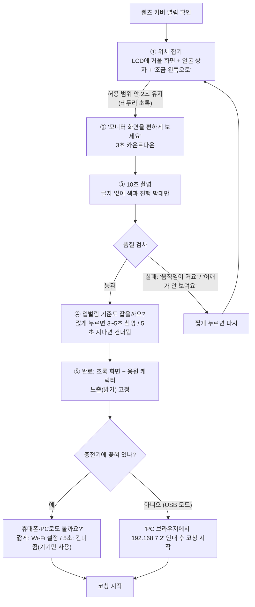

# 거북목 & 입벌림 AI 코치 — 사용자 시나리오 (상자 개봉부터)

> **문서 메타데이터**
> - **프로젝트**: 거북목 & 입벌림 AI 코치 (Neck & Mouth AI Coach / Desk Posture Coach)
> - **범위**: 사용자가 제품을 받은 순간부터 매일 쓰고, 장소를 옮기고, 넘겨주기까지의 흐름
> - **버전**: v1.0.0 (초안)
> - **작성일**: 2026-10-16
> - **기준 문서**: [PRD v1.4.1](../PRD/PRD.md), [hardware_spec_report.md v2.1.0](hardware_spec_report.md), [container_architecture.md v2.1.0](container_architecture.md)
> - **수치**: 판정 시간·스누즈 시간 등은 PRD의 시작값이며 사용자 테스트로 정합니다.

---

## 0. 등장하는 사람

| 사람 | 상황 | 주로 쓰는 모드 |
| :--- | :--- | :--- |
| **민지 (대학생)** | 집에서 모니터로 인강을 보며 공부. 데스크톱 PC에 USB-C 포트가 없음 | 충전기 + Wi-Fi 모드 (또는 오프라인) |
| **준호 (회사원)** | 회사에서 USB-C 노트북을 외부 모니터에 연결해 근무. 회사 Wi-Fi는 사번 인증 방식 | USB 모드 |

---

## 1. 상자 열기

**구성품**

| 구성품 | 비고 |
| :--- | :--- |
| 본체 (모니터 클립 일체형, 2.0" LCD, 버튼 1개, 렌즈 커버) | 렌즈 커버는 **닫힌 상태**로 출고 |
| USB-C to C 케이블 (1.5~2m) | 유일한 케이블 |
| 빠른 시작 카드 | 그림 3컷: ① 모니터 위 가운데에 끼우기 ② 케이블 꽂기 ③ 렌즈 커버 열기 |

- 충전기는 들어 있지 않습니다. 휴대폰용 USB-C 충전기(5V 2A 이상)나 PC의 USB-C 포트를 씁니다.
- 앱 설치, 회원 가입, 인터넷 연결이 **모두 필요 없습니다.**

---

## 2. 설치하기

1. **모니터 위 가운데에 끼웁니다.** 카메라가 눈높이와 같거나 조금 위에 오도록 합니다. 의자에 앉았을 때 모니터와 거리는 50~80cm입니다.
2. **케이블을 꽂습니다.** 꽂는 곳에 따라 모드가 자동으로 정해집니다.

   | 꽂은 곳 | 모드 | 할 수 있는 것 |
   | :--- | :--- | :--- |
   | PC의 USB-C 포트 (준호) | USB 모드 | 기기 단독 코칭 + 그 PC 브라우저에서 영상 보기·통계·설정. Wi-Fi는 꺼짐 |
   | USB-C 충전기 (민지) | 오프라인 → 원하면 Wi-Fi 모드 | 기기 단독 코칭. Wi-Fi를 설정하면 같은 공유기의 PC·휴대폰에서 영상 보기·통계·설정 |

3. **LCD에 "준비 중"이 뜹니다.** 부팅에 수십 초 걸립니다(실측 필요).
4. **렌즈 커버가 닫혀 있으면** 화면이 계속 검게 찍히므로, LCD에 **"렌즈 커버를 열어 주세요"** 그림이 뜹니다.

---

## 3. 처음 맞추기 (캘리브레이션) — 본체만으로

처음 켜면 캘리브레이션이 **자동으로 시작**합니다. 버튼만 쓰고, PC나 휴대폰은 필요 없습니다.

- 3단계에서 LCD를 쳐다보지 않게 하는 것이 중요합니다. 기준은 **평소 모니터를 보는 자세**여야 하기 때문입니다.
- 위치 잡기 화면의 영상은 LCD에만 나오고 기기 밖으로 나가지 않습니다.
- 준호처럼 USB 모드라면, PC 브라우저에서 `https://192.168.7.2`를 열어 같은 과정을 큰 화면으로 볼 수도 있습니다. 케이블로 1:1 연결된 PC라서 등록 코드는 필요 없습니다.

---

## 4. (선택) 휴대폰·PC와 연결하기 — 민지

민지는 통계를 휴대폰으로 보고 싶어서 3장 끝의 질문에 **짧게** 눌렀습니다.

1. LCD에 기기 자체 Wi-Fi 이름(`Coach-XXXX`)과 비밀번호가 뜹니다. **이 Wi-Fi는 10분 동안만 열립니다.**
2. 휴대폰에서 그 Wi-Fi에 접속하면 설정 페이지가 열립니다. 집 공유기 Wi-Fi를 고르고 비밀번호를 입력합니다.
3. 기기가 집 Wi-Fi로 옮겨 붙고, 자체 Wi-Fi는 닫힙니다.
4. 휴대폰(이제 집 Wi-Fi)에서 `https://coach.local`을 엽니다.
   - 브라우저가 "안전하지 않은 인증서" 경고를 띄웁니다. 시제품에서는 이 경고를 감수합니다. 대신 LCD에 뜬 인증서 지문과 페이지의 지문이 같은지 확인하게 안내합니다.
5. 페이지가 **"기기 화면의 4자리 숫자를 입력하세요"**라고 하고, LCD에 숫자가 뜹니다. 입력하면 이 휴대폰이 **등록된 기기**가 됩니다.
6. 같은 방법으로 데스크톱 PC 브라우저도 등록합니다.

- 10분 안에 끝내지 못했거나 나중에 하고 싶으면, 버튼을 **10초** 눌러 설정 메뉴 → "Wi-Fi 설정"을 고르면 다시 10분 열립니다.
- 연결하지 않아도(오프라인) 코칭 기능은 전부 그대로입니다.

---

## 5. 매일 쓰기

전원만 들어오면 매일 같은 흐름입니다. 다시 맞추지 않아도 저장된 기준을 씁니다.

| 장면 | LCD | 설명 |
| :--- | :--- | :--- |
| 바른 자세 | 응원 캐릭터 | 평소 화면 |
| 고개가 앞으로 나온 상태가 **30초** 이상 | 목을 길게 뺀 캐릭터 | 개인 기준 대비 변화로 판정. 바른 자세로 돌아오면 응원 캐릭터로 |
| 입을 벌린 상태가 **8초** 이상 | 입 벌린 캐릭터 | 말하기처럼 짧게 여닫는 움직임은 제외 |
| 같은 알림이 반복됨 | — | 쿨다운과 하루 알림 상한이 있어서 계속 울리지 않음 |
| 손·컵으로 얼굴을 가림, 고개를 크게 돌림, 너무 어둡거나 흐림 | 대기 캐릭터 | 틀린 경고 대신 **판정 보류** |
| 자리를 비움 (얼굴 없음) | "자리 비움", 화면 어둡게 | 돌아오면 바로 다시 판정 |
| 렌즈 커버를 닫음 | "일시 정지 (커버 닫힘)" | 오류가 아니라 사용자가 고른 휴식 |
| 회의·통화 중이라 알림을 끄고 싶음 | 스누즈 표시 | 버튼 **짧게**. 다시 짧게 누르면 해제. 시간은 시작값 30분, 웹 설정에서 변경 |
| 종이 책을 보며 공부 | 대기 캐릭터가 자주 뜸 | 고개를 크게 숙이면 판정 범위를 벗어남. **지원 범위 밖**임을 설명서에 명시 |

---

## 6. 기록 보기와 오탐 신고 (선택)

- **준호**: 노트북 브라우저에서 `https://192.168.7.2` / **민지**: 등록한 휴대폰이나 PC에서 `https://coach.local`
- 오늘·이번 주·이번 달 거북목, 입벌림 횟수와 유지 시간을 그래프로 봅니다. 기록은 **기기 안에** 있고, 브라우저는 보기만 합니다.
- 알림 목록에서 "이건 아니었어요"를 누르면 오탐 신고가 기록됩니다. 시제품은 기록만 하고, 민감도 자동 조정은 하지 않습니다(PRD 5.3).
- 판정 시간, 스누즈 시간, 알림 상한도 이 페이지에서 바꿉니다. 정해진 허용 범위 안에서만 바뀝니다.

---

## 7. 실시간 영상 보기 (선택)

카메라 위치를 다시 잡거나, 기기가 나를 어떻게 보고 있는지 확인하고 싶을 때 씁니다.

1. 웹 페이지에서 "영상 보기"를 누릅니다.
2. LCD에 **"PC에서 영상 보기 요청 · 3초 후 시작"**이 뜨고, 3초 뒤 영상이 나옵니다.
3. 보는 동안 LCD 구석에 **"영상 보기 중"**이 계속 표시됩니다.
4. 페이지를 닫거나 최대 시간(시작값 5분)이 지나면 끝납니다.

- Wi-Fi 모드에서는 **등록된 기기에서만** 볼 수 있습니다. USB 모드에서는 케이블로 연결된 PC만 볼 수 있습니다.
- 영상은 저장되지 않고, 인터넷으로 나가지 않습니다.

---

## 8. 다시 맞추기

| 계기 | 흐름 |
| :--- | :--- |
| 기기가 먼저 제안: 카메라가 움직였거나 조명이 크게 바뀐 것을 감지 | LCD에 "다시 맞출까요? 버튼 3초" → 사용자가 누를 때만 진행. **기준 자세는 자동으로 바뀌지 않음** (나쁜 자세가 기준이 되는 것을 막음) |
| 사용자가 원할 때 | 버튼 **3초** 또는 웹 페이지의 "다시 맞추기" |

---

## 9. 장소 옮기기 — 준호의 회사와 집

| 장소 | 연결 | 동작 |
| :--- | :--- | :--- |
| 회사 | 노트북 USB-C에 꽂음 | 자동으로 USB 모드, Wi-Fi 꺼짐. **회사 망에 붙지 않으므로 IT 승인이 필요 없음** |
| 집 | 충전기에 꽂음 | 집 Wi-Fi를 저장해 뒀다면 자동으로 Wi-Fi 모드, 아니면 오프라인 |

- 모니터 높이나 거리가 다르면 기기가 "다시 맞출까요?"를 제안합니다. 장소별 기준값을 따로 저장하는 기능은 이번 범위에 넣지 않았습니다.

---

## 10. 남에게 넘기기 / 초기화

1. 버튼 **10초** → 설정 메뉴 → "초기화"
2. LCD에 "모든 기록과 설정을 지웁니다. 3초 눌러 확인"이 뜨면 3초 누릅니다.
3. **지워지는 것**: 저장된 Wi-Fi, 등록된 기기, 개인 기준값, 알림 기록과 통계, 노출 고정값
4. 다시 켜면 1장의 처음 상태로 돌아갑니다.

- 버튼은 기기 앞에 있는 사람만 누를 수 있으므로, 웹 접속 정보를 잃어버려도 초기화할 수 있습니다.

---

## 11. 시나리오를 쓰면서 새로 정한 것 (기존 설계와 다른 점)

| # | 내용 | 기존 설계 | 바꾼 이유 |
| :---: | :--- | :--- | :--- |
| 1 | **자체 Wi-Fi는 사용자가 고를 때만 연다** (캘리브레이션 뒤 질문, 또는 10초 설정 메뉴) | 저장된 Wi-Fi 없이 충전기로 처음 켜면 자동으로 10분 열림 | 첫 화면은 핵심 기능(캘리브레이션)이 먼저. Wi-Fi가 필요 없는 사람에게는 한 번도 열리지 않아 더 안전 |
| 2 | **렌즈 커버 감지**: 화면이 계속 검으면 "커버를 열어 주세요"(설치 중) / "일시 정지"(사용 중) | 없음 | 커버를 닫은 상태가 오류나 판정 보류로 보이지 않게 |
| 3 | **자리 비움 상태**와 화면 어둡게 하기 | 판정 보류에 포함 | 자리를 비운 것과 가려진 것은 사용자에게 다른 의미 |
| 4 | **초기화 범위**에 알림 기록·통계까지 포함 | 정하지 않음 | 남에게 넘길 때 개인 습관 기록이 남지 않게 |
| 5 | **업데이트 방법이 필요**: 기기는 인터넷에 나가지 않으므로, 웹 페이지에서 서명된 업데이트 파일을 올리는 방식 | 없음 | Wi-Fi·블루투스 스택의 보안 취약점은 업데이트로 막아야 함. 인터넷 없이도 업데이트할 길이 있어야 함 |
| 6 | 사무실은 USB 모드가 기본 배포 방식이며 **"회사 망 연결 불필요"를 B2B 셀링 포인트**로 | 사용 조건으로만 언급 | IT 승인 절차가 B2B 도입의 가장 큰 장벽 |

> 위 6가지는 이 문서에서 처음 정한 것이라, 아직 PRD·하드웨어 사양서·컨테이너 설계서에는 반영하지 않았습니다.
